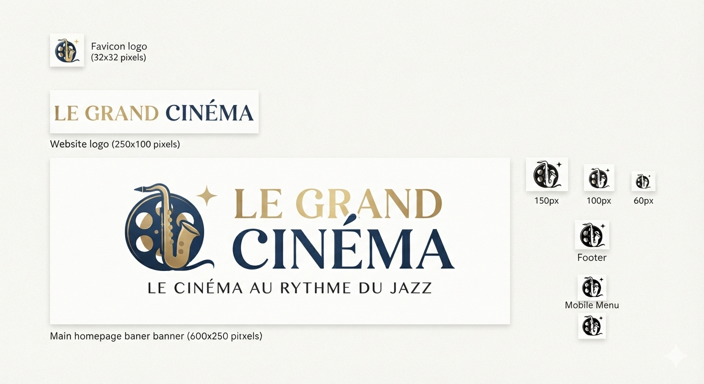

# 🎬 Le Grand Cinéma - Application de Réservation en Ligne

Ce projet consiste en la conception et la spécification d'une solution digitale (application web) pour **Le Grand Cinéma**, un lieu culturel historique doté de 10 salles (1 700 places au total). L'objectif principal de cette application est de moderniser le système de billetterie (auparavant 100 % physique) afin d'**augmenter la fréquentation globale de 30 % sur 12 mois**, notamment en absorbant efficacement les pics de charge durant le *Jazz Festival* local.

---

## 🎯 Objectifs du Projet

*   **Désengorger les guichets physiques** : Réduire le temps d'attente actuellement supérieur à 30 minutes.
*   **Capturer le chiffre d'affaires perdu** : Éviter l'abandon d'achat des spectateurs face aux files d'attente.
*   **Optimiser le taux de remplissage** : Maximiser l'occupation des 10 salles modulables (Premium/IMAX, Standard, VIP, Événementielle).
*   **Capter la clientèle touristique** : Offrir un service bilingue, moderne, fluide et accessible sur mobile.

---

## 🛠️ Choix Technologiques & Spécifications

Pour répondre aux fortes contraintes budgétaires tout en garantissant des performances optimales face aux pics de charge, la solution s'appuie sur une **architecture monolithique robuste** :

*   **Framework PHP** : Symfony (v6.4)
*   **Moteur de rendu** : Twig (Server-Side Rendering pour la rapidité du premier affichage)
*   **ORM / Base de données** : Doctrine / SQL (Gestion transactionnelle stricte pour éviter toute surréservation de sièges)
*   **Infrastructure & Hébergement** : Heroku - Cloud Public (PaaS) avec un mécanisme d'**Auto-scaling horizontal** pour dupliquer les instances applicatives automatiquement en cas de pic de trafic lors du festival.

---

## 📋 Organisation du Backlog Agile (Alignement Tableau Trello)

Le projet est piloté sur **Trello** à travers un découpage thématique par **EPICs (E0 à E5)** matérialisé par des étiquettes (Labels) de couleur, réparties au sein des listes officielles de notre flux de travail :

### 📌 Cartographie du Backlog par Colonne Trello

#### 1. Colonne : Backlogs / besoins (Définition des EPICs)
*   `E0` - Connexion et gestion des autorisations
*   `E1` - Back office d'organisation
*   `E2` - Consultation des grilles de programmes
*   `E3` - Réservation/Paiement
*   `E4` - Obtention de mes billets dématérialisés
*   `E5` - Pilotage

#### 2. Colonne : Sprints (MVP) (Périmètre prioritaire pour livraison)
*   ` US 0.0` - Navigation et affichage de la page d'accueil et Accès à la page de connexion
*   ` US 0.1` - Connexion et gestion des rôles admins (Accès back-office)
*   ` US 0.2` - Connexion et gestion des rôles spectateurs (Espace personnel)
*   ` US 1.1` - Consultation : film ou jour
*   ` US 1.2` - Consultation : places disponibles (Affichage en temps réel)
*   ` US 2.0` - Affichage des films dans un carrousel sur la page d'accueil
*   ` US 2.1` - Réservation : sélection d'un film et d'un nombre de place (Mise au panier)
*   ` US 2.2` - Réservation : paiement sécurisé
*   ` US 3.1` - Billets dématérialisés (Affichage du QR Code/Code-barres)
*   ` US 4.1` - Programmer (Création, modification et suppression de séances par l'administrateur)

#### 3. Colonne : Plus tard (Post-MVP / Évolutions futures V2)
*   ` US 1.3` - Consultation : Infos complémentaires (Pitch, distribution, liens externes)
*   ` US 2.3` - Réservation : Facture (Obtention depuis l'espace personnel)
*   ` US 2.4` - Réservation : Annulation des réservations payées
*   ` US 3.2` - Billets dématérialisés : autre méthode d'affichage
*   ` US 5.1` - Pilotage : Affichage (Graphes et tableaux représentatifs du taux de remplissage)
*   ` US 5.2` - Pilotage : Alertes (Warning sur le panneau d'administration en cas de forte affluence)
*   ` US 5.3` - Pilotage : Alerte mail (Notification automatique de forte affluence)

---

## 🚀 Installation et Lancement en Local

### Prérequis
*   PHP 8.1 ou supérieur
*   Composer
*   Symfony CLI
*   Docker / XAMPP (pour la base de données uniquement)

### Étapes d'installation

1. **Cloner le dépôt du projet :**
   ```bash
   git clone [https://github.com](https://github.com/Nathalie-Verdavoir/grand-cinema)
   cd le-grand-cinema
   ```

2. **Installer les dépendances du framework :**
   ```bash
   composer install
   ```

3. **Configuration de l'environnement :**
   Copiez le fichier `.env` en `.env.local` et configurez votre chaîne de connexion PostgreSQL :
   ```bash
   cp .env .env.local
   ```
   Configurez également `MAILER_DSN` dans `.env.local` avec la clé API de votre compte Brevo (`brevo+api://VOTRE_CLE_API@default`).

4. **Initialisation de la base de données :**
   ```bash
   php bin/console doctrine:database:create
   php bin/console doctrine:migrations:migrate --no-interaction
   ```

5. **Chargement du jeu de données de test (Fixtures des 10 salles de cinéma) :**
   ```bash
   php bin/console doctrine:fixtures:load --no-interaction
   ```

6. **Démarrage du serveur Symfony :**
   ```bash
   symfony server:start -d
   ```
   L'application est accessible localement à l'adresse : `https://127.0.0.1:8000`

---

## 📈 Liens de Conformité Académique (Livrables)

*   **Gestion du Projet & Suivi des US (Trello)** : [https://trello.com](https://trello.com/b/QQMzl3Av/le-grand-cinema)

---
© 2026 - Projet réalisé dans le cadre de la validation du Bachelor Concepteur d'application
